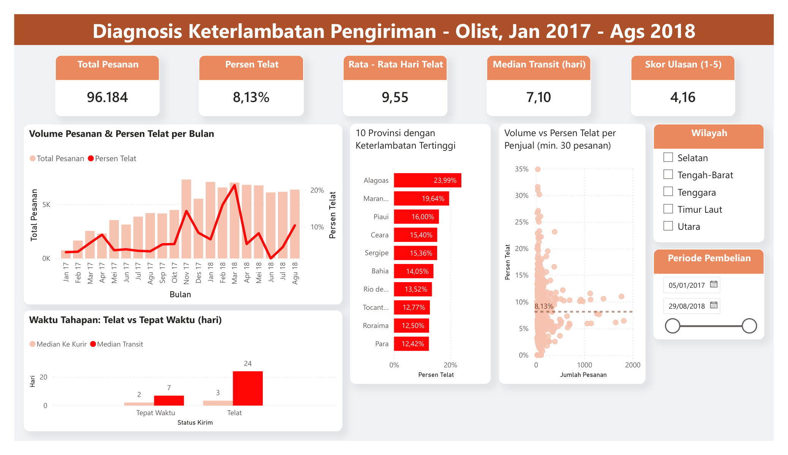
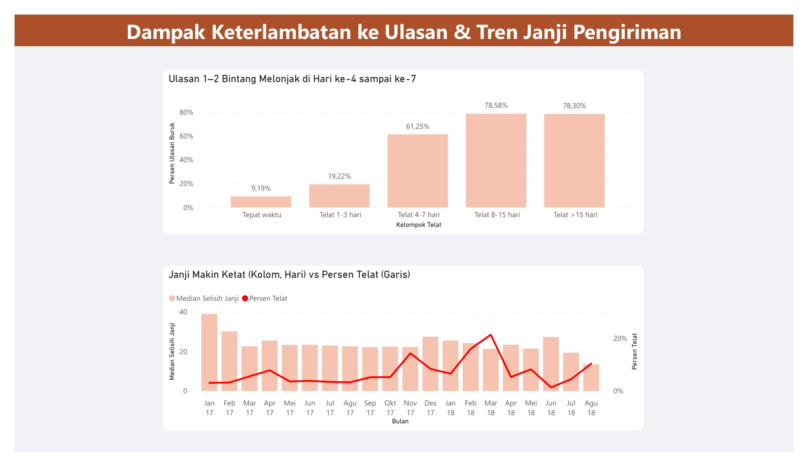

# Diagnosis Keterlambatan Pengiriman Marketplace Olist

Analisis data menyeluruh, dari data mentah sampai rekomendasi bisnis, untuk menjawab: *seberapa parah keterlambatan pengiriman Olist, di mana akar masalahnya, dan berapa kerugiannya?*

**Periode data:** Jan 2017 – Ags 2018 | **Basis analisis:** 96.184 pesanan
**Disusun oleh:** Arif Herfian Zaen Chartiko (Analis Data Operasional)
**Ditujukan untuk:** Kepala Divisi Logistik & Pemenuhan Pesanan



---

## Mulai dari Sini

| Kebutuhan                                 | Buka                                                                                                                                                                 |
| ----------------------------------------- | -------------------------------------------------------------------------------------------------------------------------------------------------------------------- |
| Ringkasan untuk rapat (13 slide)          | [`03_hasil/presentasi_diagnosis_keterlambatan.pptx`](03_hasil/presentasi_diagnosis_keterlambatan.pptx)                                                               |
| Laporan lengkap beserta alasannya         | [`03_hasil/laporan_diagnosis_keterlambatan.pdf`](03_hasil/laporan_diagnosis_keterlambatan.pdf) (juga `.docx` / [`.md`](03_hasil/laporan_diagnosis_keterlambatan.md)) |
| Menjelajah data sendiri                   | [`03_hasil/dasbor/`](03_hasil/dasbor/), dasbor Power BI (`.pbix`) beserta versi PDF-nya                                                                              |
| Pertanyaan bisnis dan data yang dipakai   | [`01_data_dan_pertanyaan/pertanyaan_bisnis.md`](01_data_dan_pertanyaan/pertanyaan_bisnis.md)                                                                         |
| Memeriksa atau menjalankan ulang analisis | [`02_proses/README.md`](02_proses/README.md)                                                                                                                         |

## Struktur Folder

```
Diagnosis Keterlambatan Pengiriman Marketplace Olist/
├── 01_data_dan_pertanyaan/   Masukan: pertanyaan bisnis + 7 CSV data mentah
├── 02_proses/                Pengerjaan: SQL, validasi Python, validasi Excel
├── 03_hasil/                 Hasil akhir: laporan, presentasi, dasbor
└── README.md
```

---

## Temuan Utama

Tingkat ketepatan waktu pengiriman (OTD) Olist = **91,87%** (8,13% pesanan telat). Terlihat sehat, tetapi ada beberapa hal yang tersembunyi di balik angka itu:

| #   | Temuan                                     | Angka kunci                                                                                   |
| --- | ------------------------------------------ | --------------------------------------------------------------------------------------------- |
| 1   | Sekali telat, telatnya jauh                | Rata-rata **9,55 hari**, terparah **188,98 hari**                                             |
| 2   | Masalah ada di jalan, bukan di gudang      | **86%** selisih waktu ada di transit kurir, hanya 14% di gudang penjual                       |
| 3   | Penyebabnya geografi, bukan penjual/produk | Maranhão **19,64%** telat vs Paraná **5,02%** (3,9x)                                          |
| 4   | Ada titik jenuh kesabaran pelanggan        | Ulasan buruk melonjak dari **19,22% → 61,25%** antara hari ke-3 dan ke-7                      |
| 5   | Kerugian terukur                           | **3.435 pelanggan kecewa** yang seharusnya tidak ada, pada pesanan senilai **BRL 1.124.036**  |

**Rekomendasi utama:** target operasional bukan "nol keterlambatan", melainkan **"jangan sampai telat lebih dari 3 hari"**, dan perbaikan diarahkan ke jaringan kurir wilayah Utara/Timur Laut, bukan ke pembinaan penjual atau penanganan produk.

## Enam Rekomendasi (diurutkan dari dampak terbesar)

1. **Arahkan perbaikan ke jaringan kurir.** 86% selisih waktu telat ada di transit; pembinaan penjual hanya menyentuh 14%.
2. **Ubah target menjadi "≤3 hari"**, bukan "nol keterlambatan". Kerusakan kepuasan melonjak di hari ke-3–7 dan jenuh setelah hari ke-8.
3. **Tetapkan batas bawah selisih janji pengiriman.** Selisih janji turun 66% dalam 20 bulan; di titik terendah (13,4 hari) keterlambatan naik lagi ke 10,39%.
4. **Prioritaskan wilayah Utara & Timur Laut** (Maranhão, Ceará, Pará, Bahia). Konsisten terburuk; Maranhão hampir 4x Paraná.
5. **Selidiki Rio de Janeiro secara terpisah.** Telat 13,52% padahal median transit hanya 8,38 hari (12.310 pesanan). Ruang janjinya setara Minas Gerais, jadi bukan soal rumus janji; masalahnya ada pada 10% pesanan paling lambat yang transitnya 24 hari atau lebih (Minas Gerais 15 hari).
6. **Siapkan dua protokol musiman yang berbeda.** Nov 2017 adalah masalah kapasitas gudang, Feb–Mar 2018 adalah gangguan jaringan kurir nasional. Satu solusi untuk keduanya akan meleset.



---

## Perangkat yang Digunakan

| Tahap                     | Perangkat                                                   |
| ------------------------- | ----------------------------------------------------------- |
| Database & pemodelan data | **PostgreSQL** (skema `raw` + `analytics`)                  |
| Analisis                  | **SQL** (fungsi jendela, `PERCENTILE_CONT`, `FILTER`, view) |
| Validasi silang           | **Python** (Pandas, SQLAlchemy) di Jupyter Notebook         |
| Validasi ketiga           | **Excel** (Power Query + rumus)                             |
| Visualisasi               | **Power BI**                                                |
| Laporan & presentasi      | Markdown, Word, PowerPoint                                  |
| Kontrol versi             | **Git**                                                     |

## Sumber Data

[Brazilian E-Commerce Public Dataset by Olist](https://www.kaggle.com/datasets/olistbr/brazilian-ecommerce) (Kaggle).

---
*Angka divalidasi 3 kali secara independen: PostgreSQL, Python (Pandas), dan Excel. Hasilnya identik.*
